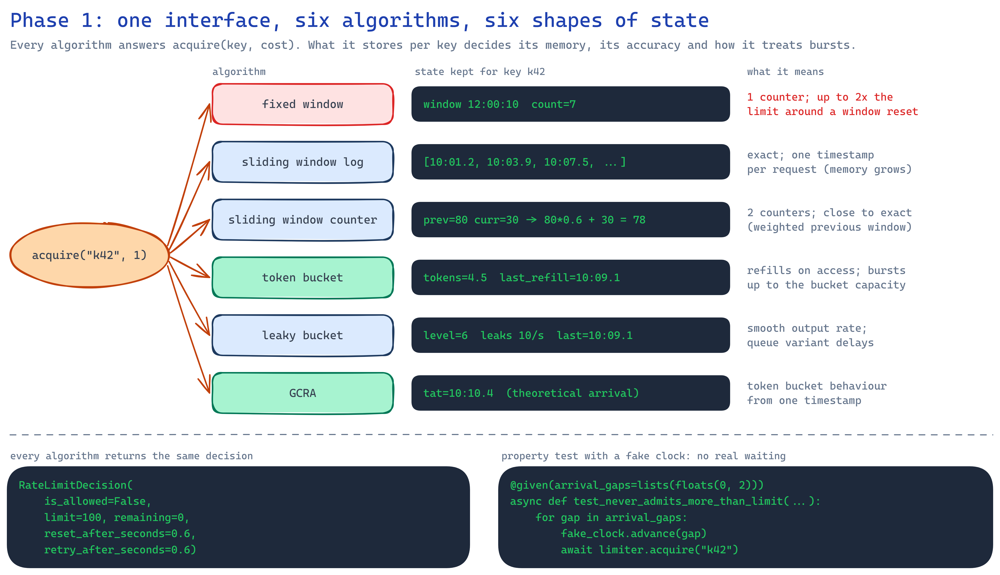

# 01 · In-memory algorithms

Six rate limiting algorithms (seven with the leaky bucket's queue variant) behind one interface,
keeping their state in a Python dict. No server and no network; this phase is about what each
algorithm stores and how it treats bursts.

<p align="center"></p>

```python
limiter = create_in_memory_limiter("token_bucket", RateLimitRule(limit=100, window_seconds=10))
decision = await limiter.acquire("k42")
# RateLimitDecision(is_allowed=True, limit=100, remaining=99, reset_after_seconds=0.1, ...)
```

## Results

`python -m ratelab.benchmark`, limit 100 requests per 10 s, from
[results/algorithm-comparison.md](results/algorithm-comparison.md):

| Algorithm | Bytes per key (full window) | Admitted from 200 at once | 100 just before + 100 just after a reset |
|---|---|---|---|
| fixed window | 173 | 100 | **200** |
| sliding window log | **1,377** | 100 | 100 |
| sliding window counter | 169 | 100 | 102 |
| token bucket | 161 | 100 | 107 |
| leaky bucket (meter) | 161 | 100 | 107 |
| leaky bucket (queue) | 113 | 100 queued | 107 |
| GCRA | 113 | 100 | 107 |

- **Fixed window lets twice the limit through** when a client sends 100 requests 0.5 s before
  the window resets and 100 more 0.2 s after it.
- **The sliding window log is the only exact one**, and it pays with memory: one timestamp per
  admitted request, 8 times more memory per key than the others.
- **The sliding window counter gets within 2%** of exact using two counters.
- **Token bucket, leaky bucket and GCRA** admit 100 plus the 7 tokens that refilled in the 0.7 s
  between the bursts, which is exactly what their rule allows.
- **GCRA keeps one float per key** and makes the same decisions as the token bucket (a test
  checks they agree on the same arrival pattern).
- Throughput is 160,000–290,000 decisions per second in one Python process for every algorithm,
  so the algorithm's own cost doesn't matter next to a network call. The full table has the
  numbers per key count.

## Tests

- **Property tests (hypothesis)** on random arrival patterns with a fake clock, for every
  algorithm: `remaining` stays between 0 and the limit; retrying after `retry_after_seconds`
  always succeeds; fixed and sliding counter never pass the limit within one aligned window; the
  log never passes it in any rolling window; buckets and GCRA never pass `capacity + rate x time`;
  the leaky queue releases requests no faster than the leak rate.
- **Example tests** for each algorithm's specific behaviour, idle-key eviction and the
  benchmark.
- 29 tests, 99% coverage.

## Run it

```powershell
python -m venv .venv
.\.venv\Scripts\python.exe -m pip install -e ".[dev]"
.\.venv\Scripts\python.exe -m pytest
.\.venv\Scripts\python.exe -m ratelab.benchmark      # writes results/algorithm-comparison.md
```

## Design notes

- `try_acquire` never awaits, so on one asyncio event loop no other request can run between
  reading and writing a key's state. No lock is needed in memory; phase 3 needs Lua for the same
  guarantee across processes.
- Each key's state expires when its limit has fully reset, so idle keys don't keep memory.
- Time comes from an injected `Clock`. Tests use `FakeClock`, so nothing waits in real time.

## When to use this in production

Only for a single process: a CLI, a worker, or one replica that will never scale out. Pick the
token bucket (or GCRA) when short bursts are fine, the sliding window counter when you want
"N per window" to read like it sounds, and avoid the fixed window for anything a client could
time against its reset.
