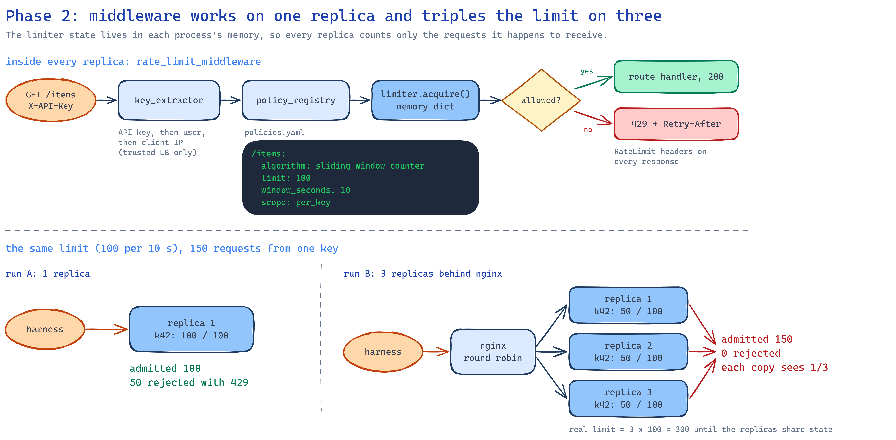

# 02 · Single-node middleware

The standard API (FastAPI) with a rate limiting middleware. Limits come from `policies.yaml`, and
the limiter state lives in each process's memory. One replica works. Three replicas behind nginx
each count on their own, so the real limit triples.

<p align="center"></p>

## How a request is handled

1. `key_extractor`: the caller is the `X-API-Key`, else `X-User-Id`, else the client IP.
   `X-Forwarded-For` is believed only from a trusted proxy network, so a client can't choose
   its own IP.
2. `policy_registry`: finds the route's policy (algorithm, limit, window, burst, per key or
   global) from `policies.yaml`, validated at startup.
3. `limiter.acquire()` decides. Allow-listed API keys skip the limit.
4. Every limited response gets `RateLimit-Policy` and `RateLimit` (IETF draft). A rejection is
   `429` with `Retry-After` in whole seconds and `{"detail": "rate limit exceeded", "policy": …}`.
   The leaky bucket queue variant waits `delay_seconds` instead of rejecting.

```text
HTTP/1.1 429 Too Many Requests
ratelimit-policy: "items";q=100;w=10
ratelimit: "items";r=0;t=20
retry-after: 14
x-replica-id: 4fc480564f98
```

## Results

Harness reports in [results/](results/).

| Suite | Run A: 1 replica | Run B: 3 replicas | Run C: 1 replica, fixed window |
|---|---|---|---|
| accuracy (150 at 50/s, limit 100) | ✅ 100 | ❌ 150 | ✅ 100 |
| boundary_burst (100 + 100 around a reset) | ✅ 102 | ❌ 200 | ❌ **200** |
| concurrency (200 at once) | ✅ 100 | ❌ 200 | ✅ 100 |
| global_limit (600 requests, limit 300) | ✅ 300 | ❌ 600 | ✅ 300 |
| headers (110 sequential) | ✅ | ❌ no 429 at all | ✅ |
| latency_overhead (p95) | ✅ 3.4 vs 3.0 ms | ✅ 3.6 vs 3.7 ms | ✅ 2.8 vs 3.1 ms |

- **One replica is exact.** 100 of 150, 100 of 200 parallel, 300 of 600 on the global limit.
- **Three replicas let everything through.** Each replica sees a third of the traffic and never
  reaches its own limit; a client also sees `remaining` jump around, because each response comes
  from a different replica's count.
- **The fixed window fails only the boundary test**: 200 requests pass in 1.3 s when they straddle
  a reset. The sliding window counter (run A) lets 102 through.
- **The limiter adds no measurable latency** in memory.
- **Load** (Locust, 100 → 300 users, about 1 minute): 21,354 requests, 0 errors; `/search` admitted
  1,728 against its 300 per 10 s global limit. Locust used 90% of a CPU at about 350 requests/s,
  so its latency numbers measure the laptop, not the API.

## Run it

```powershell
docker compose up -d --build --wait                         # run A: 1 replica
$env:API_REPLICAS="3"; docker compose up -d --wait; docker compose restart nginx       # run B
$env:API_REPLICAS="1"; $env:RATELAB_POLICIES_FILE="policies-fixed-window.yaml"
docker compose up -d --wait; docker compose restart nginx                              # run C

cd ..\rate-harness
$env:HARNESS_ENV_FILE="../02-single-node-middleware/harness/single-replica.env"   # or three-replicas.env, fixed-window.env
.\.venv\Scripts\python.exe -m pytest tests/suites -rxXs
```

nginx resolves `api` to every replica's IP when it starts, so restart it after scaling.

Unit tests (no Docker): `.\.venv\Scripts\python.exe -m pytest`, 40 tests, 99% coverage.

## When to use this in production

One replica only, or as a per-instance safety net in front of a shared limiter. A limit kept in
each replica's memory is really `limit × replicas`, and it changes every time the service scales.
