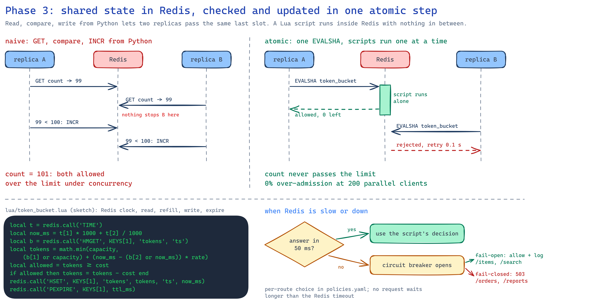
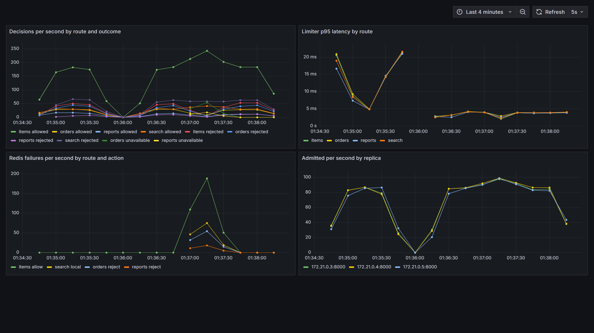

# 03 · Redis + Lua

The same API, three replicas behind nginx, and one Redis that holds every limit. Each algorithm
is a Lua script: Redis reads the key, decides and writes it back in one step, with nothing in
between. Each route decides what happens when Redis is slow or down.

<p align="center"></p>

## How it works

- **One script per algorithm** in [src/ratelab/lua/](src/ratelab/lua/). Every script reads the
  time with Redis `TIME`, so replicas with different clocks still agree, and sets a TTL so idle
  keys disappear. Scripts are registered once and called with `EVALSHA`; after a `SCRIPT FLUSH`
  redis-py loads them again on `NOSCRIPT`.
- **Keys carry a hash tag**, `rl:{items:key:k42}:sliding_window_counter`, so all of one caller's
  keys land in one slot when phase 4 moves to Redis Cluster.
- **Two variants without Lua** for comparison: `fixed_window_naive` (GET, compare in Python,
  INCRBY) and `fixed_window_incr` (INCRBY first, compare after, `EXPIRE NX`). Pick one per route
  with `RATELAB_ALGORITHM_OVERRIDES={"items": "fixed_window_naive"}`.
- **When Redis fails**, each route follows `on_store_failure` in `policies.yaml`:

| Route | `on_store_failure` | While Redis is down |
|---|---|---|
| `GET /items` | `allow` | every request passes (fail open) |
| `POST /orders`, `POST /reports` | `reject` | `503` with `Retry-After` (fail closed) |
| `GET /search` | `local` | each replica counts on its own at limit / 3 |

  Calls time out after 50 ms. After 3 failures in a row a circuit breaker skips Redis for 2 s,
  so requests don't each wait for the timeout. The connection pool waits for a free connection
  instead of raising "Too many connections", which the breaker would mistake for Redis being down.
- **Metrics** on `/metrics` of every replica: decisions by route and outcome, limiter latency,
  Redis failures by route and action. `docker compose --profile observability up -d` adds
  Prometheus (:9090) and a provisioned Grafana dashboard (:3000).

## Results

Harness reports in [results/](results/), 3 API replicas for every run.

### Lua against the race condition

| Suite | naive GET + INCR | INCRBY + EXPIRE NX | Lua (sliding window counter) |
|---|---|---|---|
| 200 requests on one key at once (limit 100) | ❌ **117** | ✅ 100 | ✅ 100 |
| 100 + 100 around a window reset | ❌ 200 | ❌ 200 | ✅ 102 |
| 150 at 50/s on one key | ✅ 100 | ✅ 100 | ✅ 100 |
| 600 on the 300 global limit, 3 replicas | ✅ 300 | ✅ 300 | ✅ 300 |

- **The naive version over-admits by 17%** when requests arrive together: several replicas read
  the same count before any of them writes.
- **INCRBY first is exact** without Lua, but it is still a fixed window, so it doubles the limit
  around a reset. Lua is what lets the better algorithms run atomically.
- **The same three replicas that let 150 of 150 through in phase 2** now let exactly 100 through.

### Every algorithm on Redis

`/items`, limit 100 per 10 s, 3 replicas
([results/algorithms/](results/algorithms/)):

| Algorithm | 200 at once | 100 + 100 around a reset | 150 at 50/s | Limiter p95 vs `/ping` |
|---|---|---|---|---|
| fixed window | 100 | **200** | 100 | 4.0 vs 2.8 ms |
| sliding window log | 100 | 100 | 100 | 4.5 vs 2.8 ms |
| sliding window counter | 100 | 102 | 100 | 4.4 vs 2.8 ms |
| token bucket | 102 | 113 | 129 | 8.7 vs 4.5 ms |
| leaky bucket | 102 | 112 | 129 | 2.9 vs 2.1 ms |
| GCRA | 102 | 112 | 129 | 4.3 vs 3.7 ms |

The numbers match phase 1's in-memory benchmark. The buckets and GCRA admit 129 of 150 over 3 s
because they refill at 10 per second, which is their rule. The 2 extra in the parallel burst
refilled while Redis worked through it. Redis adds about 1–2 ms at p95 on this laptop; the
token bucket run was noisy (`/ping` itself took 4.5 ms).

### Redis paused

The harness runs `docker pause` on Redis, sends requests, then unpauses it:

| Route | Result | Slowest request |
|---|---|---|
| `/items` (allow) | 10 / 10 answered 200 | 59 ms |
| `/orders` (reject) | 10 / 10 answered 503 | |
| after unpause | `/orders` answers 200 again | |

Under load (80 users, Redis paused for 20 s in the middle): 0 errors on `/items`, 1,505 `503`s on
`/orders` and 497 on `/reports`, and `/search` kept limiting through the per-replica fallback.

<p align="center"></p>

## Run it

```powershell
docker compose up -d --build --wait                      # Redis + 3 API replicas + nginx on :8080
docker compose --profile observability up -d             # optional: Prometheus :9090, Grafana :3000

cd ..\rate-harness
$env:HARNESS_ENV_FILE="../03-redis-centralized/harness/redis-lua.env"
.\.venv\Scripts\python.exe -m pytest tests/suites -rxXs
```

| Setup | API setting | Harness settings |
|---|---|---|
| Lua (default) | none | `harness/redis-lua.env` (includes the Redis pause) |
| naive GET + INCR | `$env:RATELAB_ALGORITHM_OVERRIDES='{"items": "fixed_window_naive"}'` | `harness/naive.env` |
| INCRBY + EXPIRE NX | `$env:RATELAB_ALGORITHM_OVERRIDES='{"items": "fixed_window_incr"}'` | `harness/incr.env` |

After changing the API setting, run `docker compose up -d --wait; docker compose restart nginx`.

Unit tests need a Redis (`docker compose up -d redis`), because Lua under fakeredis behaves
differently: `.\.venv\Scripts\python.exe -m pytest`, 60 tests, 99% coverage. Without Redis
the Redis tests are skipped.

## When to use this in production

This is the standard answer: a shared Redis, one Lua script per decision, a short timeout, a
circuit breaker, and a per-route choice between failing open and failing closed. It stops being
enough when one Redis can't take the traffic, or one key gets most of it (phase 4).
