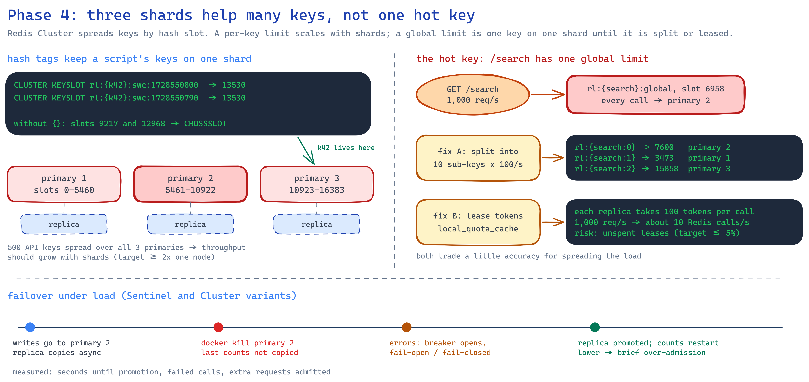

# 04 · Redis Cluster scaling

The phase 3 limiter on more than one Redis: a 6-node Redis Cluster (3 primaries + 3 replicas) or a
primary/replica pair behind Sentinel. Two ways to keep one busy key off a single shard, and what
happens to the limit while a primary dies.

<p align="center"></p>

## What changed from phase 3

- **`RATELAB_REDIS_MODE`**: `single`, `cluster` (all six nodes as seeds) or `sentinel` (asks the
  Sentinels for the current primary).
- **Hot key strategies**, per route in `policies.yaml`:
  - `split`: the limit is divided over `split_count` sub-keys with different hash tags, so they land
    on different primaries; each request picks one at random.
  - `lease`: each API replica takes `lease_size` tokens from Redis in one call and hands them out
    locally until they run out or expire after `lease_ttl_seconds`. Leased tokens are already
    counted, so the limit is never exceeded. Once Redis refuses, the replica refuses locally until
    the retry-after time, so rejected traffic stops reaching Redis.
- **`RATELAB_POLICY_OVERRIDES`** replaces phase 3's algorithm overrides and can change any policy
  field, e.g. `{"search": {"hot_key_strategy": "lease"}}`.
- **Any store fault follows the route's failure policy**, not only Redis errors: under a burst,
  redis-py's async cluster client raised `RuntimeError` / `AttributeError` on connections closed
  after a timeout, and those became 500s.
- **Separate connect timeout** (250 ms) from the 50 ms command timeout.

## Results

All raw tables are in [results/](results/).

### Script throughput: one Redis vs the cluster

The Lua script called straight against Redis by memtier_benchmark inside the Compose network
([store-throughput.md](results/store-throughput.md)), 0 failed calls in every run:

| Setup | Script calls/s | Where the load went |
|---|---|---|
| one node, 100,000 keys | 62,807 | one Redis at 96% CPU |
| cluster, 100,000 keys | 49,334 (60,934 with 8 client threads) | 3 primaries at ~98% CPU each |
| cluster, one hot key | **39,297** | one primary; the other two idle |
| cluster, hot key split into 10 | **63,109** | spread over all 3 primaries |

- **Splitting the hot key gives 1.6x** on the cluster: the same traffic now uses all three shards.
- **Sharding did not beat one node here.** Every Redis process and the load generator share this
  laptop's 4 physical cores, so three primaries at 98% each do the work one node did at 96%.
  The plan's "3 primaries ≥ 2x one node" needs each shard on its own cores or machine.
- A first attempt with a Python load generator reached only 20,000–25,000 calls/s in every
  setup: it measured the client, so it was replaced.

Two keys in one script: without a shared hash tag they hash to slots 6551 and 14097, redis-py
refuses (`all keys must map to the same key slot`) and Redis answers
`CROSSSLOT Keys in request don't hash to the same slot`. With `{items:key:k42}` both are in slot
9241 and the script runs.

### Hot key: one global limit, three ways

`/search`, 300 per 10 s for all callers, 600 requests through 3 API replicas
([hot-key-strategies.md](results/hot-key-strategies.md)):

| Strategy | Admitted | Redis script calls | Calls per primary |
|---|---|---|---|
| none | 300 | 600 | 600 / 0 / 0 |
| split into 10 | 300 | 600 | 184 / 173 / 243 |
| lease 30 tokens | 300 | **16** | 16 / 0 / 0 |

Both strategies keep the limit exact. Split spreads the calls; leasing removes 97% of them.
The cost of leasing: tokens a replica leased and did not use in 1 s are lost.

With cold connections (right after the API replicas restarted) the same test admitted 376–448:
calls timed out at 50 ms while connections were still being opened, the shared circuit breaker
opened, and `/search` fell back to its per-replica local limit.

### A primary dies

One API key at 20 requests/s on `/items` (limit 100 per 10 s, fail-open). The primary that owns
the key is stopped at 10 s and started again at 30 s
([failover-cluster.md](results/failover-cluster.md),
[failover-sentinel.md](results/failover-sentinel.md),
[failover-before-ip-endpoints.md](results/failover-before-ip-endpoints.md)):

<p align="center"></p>

- **With IP addresses, both recover in about 9 s**: 2 s until the node is declared down, the
  replica's promotion, and the client finding it. Requests fail open in between with 0 errors;
  the old primary rejoins as a replica without a blip. Limiting resumes at 10/s, with no burst
  from counts lost to asynchronous replication.
- **With hostnames, both failed.** A stopped container's name takes 8 s to fail on Docker's DNS
  (`getaddrinfo` for a live node: 0.02 s). The API resolves names on asyncio's 12 resolver
  threads; lookups of the dead name filled them, connections to healthy nodes timed out too, and
  the cluster client could not rebuild its slot map until the node came back: **the limit was not
  enforced for 24 s**. Redis resolves on its main thread, so the Sentinel froze, marked every
  peer down, entered TILT mode and never failed over.

### API replicas 1, 3 and 6

About 300–400 requests/s with 0 failures in every case
([replica-scaling.md](results/replica-scaling.md)). One Locust process on the same laptop is the
ceiling, and the replicas share its CPUs, so more replicas add nothing here.

## Run it

```powershell
docker compose -f compose.yaml -f compose.cluster.yaml up -d --build --wait     # cluster
docker compose -f compose.yaml -f compose.sentinel.yaml up -d --build --wait    # or Sentinel

cd ..\rate-harness
$env:HARNESS_ENV_FILE="../04-redis-cluster-scaling/harness/cluster.env"         # or sentinel.env
.\.venv\Scripts\python.exe -m pytest tests/suites -rxXs

# a primary dies while one key sends 20 requests/s
.\.venv\Scripts\python.exe -m rateharness.outage_timeline --path /items --rate 20 --seconds 40 `
  --event "10=docker stop ratelab-phase4-redis-primary-1" `
  --event "30=docker start ratelab-phase4-redis-primary-1"
```

Hot key strategy for one run: `$env:RATELAB_POLICY_OVERRIDES='{"search": {"hot_key_strategy":
"lease"}}'`, then `docker compose ... up -d --wait` and `docker compose ... restart nginx`.

Script throughput: load the script on every node
(`docker exec <node> sh -c "redis-cli -x SCRIPT LOAD < /tmp/limiter.lua"` after `docker cp`), then
`docker compose -f compose.yaml -f compose.cluster.yaml run --rm memtier -s redis-node-1
--cluster-mode -t 4 -c 25 --pipeline 32 --test-time 10 --command="EVALSHA <sha> 1 __key__ 100 10 1
100" --command-key-pattern=R --key-prefix=bench:key --key-maximum=100000`.

Unit tests (Redis on :6379 for the Redis tests): `.\.venv\Scripts\python.exe -m pytest`, 72 tests,
99% coverage.

## When to use this in production

Shard when one Redis runs out of CPU, and give each shard its own cores. Keep a limiter's keys
under one hash tag. For a single very hot limit, leasing cuts Redis calls by an order of magnitude
at the cost of a little unused quota; splitting spreads the load but rejects early when the random
sub-key is empty. Advertise IP addresses (or make sure DNS fails fast) and test a primary kill
under load before trusting failover.
