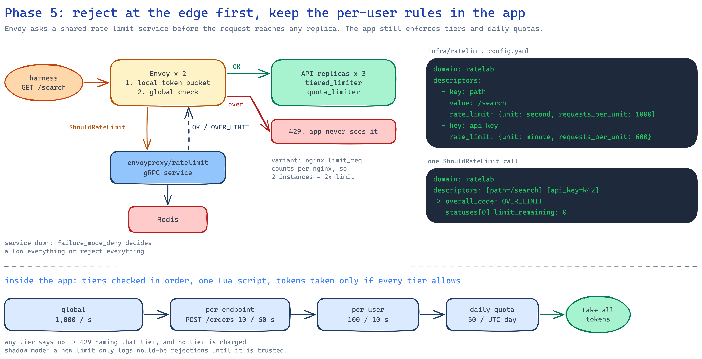

# 05 · Edge rate limiting

Limiting before a request reaches the app, with nginx `limit_req`, Envoy's local token bucket, or
Envoy asking `envoyproxy/ratelimit`, measured against the app's own Redis limiter. The app gets
tiered limits (per caller, per endpoint, per user, global, daily quota) checked in one Lua
script, and a shadow mode for rolling out a new limit.

<p align="center"></p>

## The setup

```text
                  :8080 ─▶ Envoy x2 ── global limit, fail open ──┐
                  :8083 ─▶ Envoy x2 ── global limit, fail closed ┤   envoyproxy/ratelimit ─▶ Redis
harness ─▶ front  :8084 ─▶ Envoy x2 ── local token bucket ───────┤
                  :8081 ─▶ nginx x1/x2 ── limit_req ─────────────┼─▶ API x3 (tiers) ─▶ Redis
                  :8082 ─────────────────────────────────────────┘
```

## Tiered limits in the app

Each route in `policies.yaml` lists tiers; `tiered_limit.lua` checks all of them and charges
every tier only if all allow, so a request rejected by the user tier spends nothing from the
daily quota.

| Route | Tiers |
|---|---|
| `GET /items` | 100 / 10 s per key on this route, 200 / 10 s per user on every route, 2,000 / s global |
| `POST /orders` | 10 / 60 s per key (burst 5), 100 / 60 s for the endpoint, user, global |
| `GET /search` | 300 / 10 s for the endpoint, global |
| `POST /reports` | 50 per UTC day per key (fixed window), user, global |

Every tier is reported:

```text
RateLimit-Policy: "items";q=100;w=10, "user";q=200;w=10, "global";q=2000;w=1
RateLimit: "items";r=99;t=12, "user";r=199;t=12, "global";r=1999;t=1
```

A 429 names the tier that refused (`{"detail": "rate limit exceeded", "policy": "user"}`).
`mode: shadow` checks and records (`ratelab_decisions_total{decision="shadow_rejected"}`) but
never rejects. `RATELAB_POLICY_OVERRIDES='{"*": {"mode": "shadow"}}'` puts every route in shadow
mode.

## Results

From [results/edge-comparison.md](results/edge-comparison.md), limits `/items` 100 per key and
`/search` 300 for everyone (per minute for Envoy's global limit):

| Enforced by | 200 at once on one key | 100 + 100 around a reset | 600 on the global limit | Headers |
|---|---|---|---|---|
| app, tiered Lua in Redis | 100 | 102 | 318 | IETF `RateLimit`, every tier |
| Envoy x2 + rate limit service | 100 | **200** | 300 (313 cold) | `X-RateLimit-*` |
| Envoy x2, local token bucket | – | – | **600** | none |
| nginx `limit_req` x1 | 101 | 113 | 313 | none |
| nginx `limit_req` x2 | **200** | **200** | **600** | none |

- **Per-instance counters multiply with the instances.** Two nginx or two Envoy local buckets let
  600 through a 300 limit, the same failure as phase 2's three in-memory replicas. They work as a
  coarse per-instance shield, not as the limit.
- **Envoy + the rate limit service is exact across Envoys**, but counts in fixed windows of one
  second / minute / hour / day: 200 got through around a minute boundary. A 10-second window
  can't be expressed, and the headers describe one limit, not each tier.
- **The app is the only place that knows the user, the route and the business rules**, and the
  only one here with tiers, quotas, shadow mode and per-route fail-open / fail-closed.
- The 318 and the cold 313 are calls that hit the 50 ms timeout during the burst and failed open;
  warm, Envoy's global limit gave exactly 300.
- An nginx config bug worth knowing: keying a zone on an empty variable (`$server_name` with no
  `server_name`) disables the limit, because nginx skips requests whose key is empty.

When the rate limit service stops for 10 s: with `failure_mode_deny: false` every request is
admitted; with `true` every request gets 503. Both add the full 50 ms gRPC timeout to every
request while the service is down (no circuit breaker in front of it), and limiting resumes
within 1 s of a restart.

## Run it

```powershell
docker compose up -d --build --wait

cd ..\rate-harness
$env:HARNESS_ENV_FILE="../05-edge-rate-limiting/harness/app.env"     # API on :8082
.\.venv\Scripts\python.exe -m pytest tests/suites -rxXs
```

For the edge runs put the API in shadow mode and restart the proxies (they resolve replica
addresses at start):

```powershell
$env:RATELAB_POLICY_OVERRIDES='{"*": {"mode": "shadow"}}'; $env:EDGE_NGINX_REPLICAS="2"
docker compose up -d --wait; docker compose restart envoy edge-nginx; docker compose restart front
```

| Path | Port | Harness settings |
|---|---|---|
| Envoy + rate limit service | 8080 (fail open), 8083 (fail closed) | `harness/envoy-global.env` |
| Envoy local token bucket | 8084 | `harness/envoy-local.env` |
| nginx x2 / x1 (`EDGE_NGINX_REPLICAS`) | 8081 | `harness/nginx-edge.env`, `nginx-edge-single.env` |

Envoy's counters: `docker run --rm --network ratelab-phase5_default curlimages/curl:8.10.1 -s
http://ratelab-phase5-envoy-1:9901/stats | findstr ratelimit`.

Unit tests (Redis on :6379 for the Redis tests): `.\.venv\Scripts\python.exe -m pytest`, 23 tests,
98% coverage.

## When to use this in production

Put a coarse per-instance limit at the edge (nginx or Envoy local) to absorb floods cheaply, use a
shared counter (Envoy's rate limit service or the app on Redis) for the limit you promise, and
keep tiers, quotas and anything that needs the user or the plan in the app. Roll a new limit out
in shadow mode first, and decide per route whether a limiter outage should fail open or closed.
