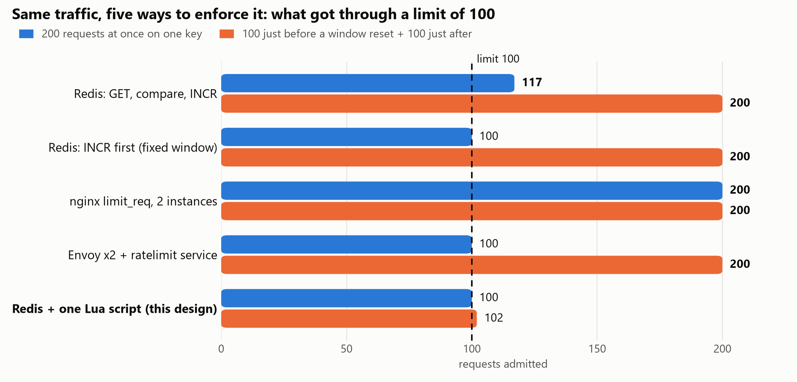
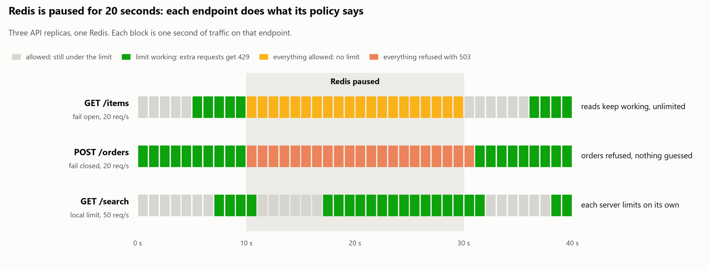
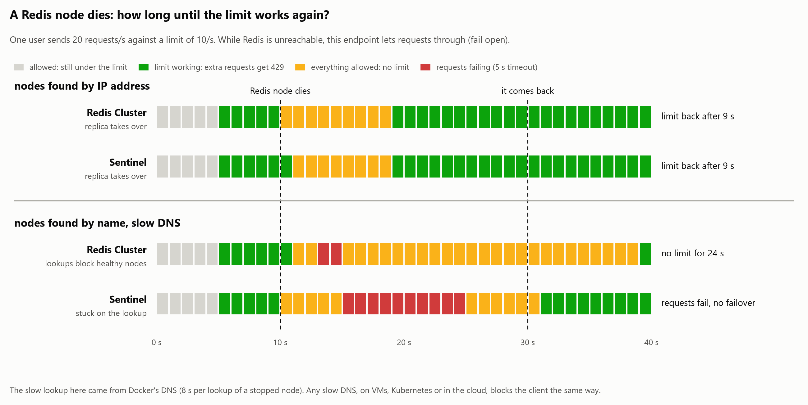

# Distributed Rate Limiter (Redis + Lua)

[](./LICENSE)

**Someone is hitting your API again and again.** Maybe it's a bot, maybe a buggy app stuck in a
retry loop: 500 requests a second on your orders endpoint, and everyone else's checkout slows
down. So you add a rate limit, 100 requests per 10 seconds per user, and keep the counts in the
server's memory. It works.

Then, one by one, things break:

- **You deploy and the server restarts.** Every count is back to zero.
- **Traffic grows, so you run three servers** behind a load balancer. Each one keeps its own
  count, so a user who should get 100 now gets 300.
- **You move the counts into Redis**, one place every server shares. Now two servers read "99"
  at the same moment, and both say yes.
- **The Redis node dies.** Every request waits on a server that isn't there. Do you let everyone
  in, or block everyone?
- **You move to a Redis Cluster** for safety and speed, and find that your "300 searches per
  10 seconds for everyone" limit is a single key: one node does all the work while the other
  two sit idle.

Every step raises the next question: where does the count live, how do servers agree on it, what
happens when Redis goes down, and how does it scale? This project answers them one at a time and
measures every answer. The result is a rate limiter that holds the limit **exactly, across any
number of servers**: one small Lua script in Redis reads, decides and writes in a single step,
Redis Cluster spreads the keys, the hot key is split or handed out in batches, each endpoint has
a plan for Redis being down, and nginx or Envoy throws away floods before they reach the app.

For example, Riya's network is slow, so she taps **Place order** six times in one second. The
first five go through (orders allow a burst of 5), and the sixth gets `429` with
`Retry-After: 5`, whichever of the three servers it lands on. A few minutes later Redis crashes:
the menu keeps loading, orders get a quick `503` instead of a guess, and after three failed calls
the API stops waiting on Redis at all until it's back.

<p align="center">
  
</p>

**Every claim here is measured.** One test harness throws the same traffic at every version: 200
requests at the same instant, bursts on both sides of a window reset, Redis paused under load, a
Redis primary killed mid-traffic. The numbers below come from those runs.

---

## How it works

A request passes four checkpoints. Each one exists because the simpler version broke:

- **Edge shield (nginx / Envoy):** a generous per-instance limit that drops floods before they
  cost the app anything. It is *not* the real limit: two proxies each count on their own, so
  they let twice the limit through.
- **Middleware in every API replica:** works out who is calling (API key, then user, then client
  IP, trusting `X-Forwarded-For` only from known proxies) and which limit applies to this route,
  from `policies.yaml`.
- **One Lua script in Redis:** the algorithm runs *inside* Redis, so read, decide and write happen
  with nothing in between. It uses Redis's clock, so servers with different clocks still agree,
  and every key expires on its own once it's idle.
- **A plan for when Redis fails:** a 50 ms timeout, a circuit breaker that stops calling a dead
  Redis after 3 failures, and a per-route choice: let reads through, refuse orders with `503`, or
  fall back to a rough local limit.

Behind that, Redis Cluster spreads the keys over three primaries. The `{hash tag}` in each key
keeps one caller's keys on one node. A limit shared by everyone (one key, so one node) is split
into sub-keys or handed out in batches of 30 tokens. A request can also be checked against
several limits at once (per key, per endpoint, per user, global, daily quota), and nothing is
charged unless all of them allow it.

---

## Concepts used

| Concept | In plain words |
|---|---|
| **Six algorithms** | Fixed window, sliding window log, sliding window counter, token bucket, leaky bucket and GCRA, all behind one `acquire(key, cost)` call, so a route switches algorithm with one line of config. |
| **Atomic check with Lua** | The count is read, compared and updated in one step inside Redis, so 200 simultaneous requests can't all see "99". |
| **Redis Cluster + hash tags** | Keys spread over several Redis nodes; `rl:{orders:key:k42}:…` keeps one caller's keys together so one script can use them. |
| **Hot keys** | A global limit is one key on one node. Split it into 10 sub-keys, or let each server lease 30 tokens at a time (97% fewer Redis calls). |
| **Fail open / fail closed** | When Redis is down, each endpoint decides: allow (reads), refuse with `503` (orders), or count locally. |
| **Circuit breaker** | After repeated failures, stop calling Redis for 2 s instead of making every request wait for a timeout. |
| **Failover** | Redis Cluster and Sentinel promote a replica when a primary dies; measured end to end, including a DNS trap that stalled it. |
| **Edge rate limiting** | nginx `limit_req`, Envoy's local token bucket, and Envoy with `envoyproxy/ratelimit`, compared on the same traffic. |
| **Tiered limits + shadow mode** | Several limits per request, all charged or none; a new limit can run in shadow mode, logging who it *would* refuse, before it's enforced. |
| **Standard headers** | `429` with `Retry-After`, plus the IETF `RateLimit` / `RateLimit-Policy` headers on every response so clients can slow down early. |
| **Observability** | Prometheus metrics per route and outcome, and a Grafana dashboard. |

---

## What I measured

### 1. Same traffic, five implementations

Limit 100 per 10 s on one key, three API replicas. Blue: 200 requests released at the same
instant. Orange: 100 just before a window resets and 100 just after.

<p align="center"></p>

- **Read, compare, then write** lets 117 through: several servers read the same count before any
  of them writes.
- **Increment first** fixes that, but it's stuck with a fixed window, which doubles the limit
  around a reset.
- **Proxies** either count per instance (nginx: 2 instances, 2× the limit) or only in fixed
  windows (Envoy's service).
- **One Lua script** holds both, and adds about 1–2 ms at p95.

### 2. Six algorithms, one burst

100 requests 0.5 s before a fixed window resets and 100 more 0.2 s after it
([full table](01-in-memory-algorithms/results/algorithm-comparison.md)):

| Algorithm | Admitted | Bytes per key |
|---|---|---|
| fixed window | **200** | 173 |
| sliding window log | 100 | **1,377** |
| sliding window counter | 102 | 169 |
| token bucket / leaky bucket | 107 | 161 |
| GCRA | 107 | 113 |

Only the log is exact, and it stores a timestamp per request. The sliding window counter gets
within 2% with two numbers, so it's the default here. The buckets and GCRA admit the 7 tokens
that refilled between the bursts, which is exactly their rule.

### 3. Redis stops answering

Redis is paused from 10 s to 30 s while traffic keeps coming. Each endpoint does what its
policy says, with no errors and no request stuck waiting:

<p align="center"></p>

- **`/items` (fail open):** reads keep working, unlimited, while Redis is away.
- **`/orders` (fail closed):** refused with a quick `503` and `Retry-After`, never guessed.
- **`/search` (local limit):** each of the 3 servers limits on its own, at a third of the limit.

In a longer load test (80 users, Redis paused for 20 s) the limiter's p95 stayed around 4 ms, and
`/items` had 0 errors ([phase 03](03-redis-centralized/README.md), with the Grafana dashboard).

### 4. One key everybody hits

`/search` has one limit for all callers, so on a 3-node Redis Cluster every call lands on one
node ([phase 04](04-redis-cluster-scaling/README.md)):

| Strategy | Admitted (limit 300 of 600) | Redis calls | Calls per node |
|---|---|---|---|
| one key | 300 | 600 | 600 / 0 / 0 |
| split into 10 sub-keys | 300 | 600 | 184 / 173 / 243 |
| lease 30 tokens per call | 300 | **16** | 16 / 0 / 0 |

Straight against Redis, splitting the hot key raised script throughput from 39,297 to 63,109
calls/s, because all three nodes did work instead of one.

### 5. A Redis primary dies mid-traffic

One key at 20 requests/s; the primary holding it is stopped at 10 s:

<p align="center"></p>

- **Clients that reach Redis nodes by IP address** recover in about 9 s: a replica takes over,
  requests fail open in between with 0 errors, and the limit works again.
- **Clients that look nodes up by name** depend on DNS. When the dead node's name is slow to
  resolve, the slow lookups fill the client's resolver threads, so it can't reach the *healthy*
  nodes either: the limit was off for 24 s. Sentinel resolves names on its single thread, so it
  froze and never promoted the replica.
- **The fix:** nodes announce IP addresses (Redis Cluster's default), or DNS must fail fast. The
  slow lookup here came from Docker's DNS (8 s for a stopped node), but a slow DNS server on VMs,
  Kubernetes or in the cloud causes the same failure.

### 6. Limiting at the edge

Two nginx or two Envoy local buckets let **600 through a limit of 300**: a per-instance count
multiplies with the instances. Envoy with `envoyproxy/ratelimit` is exact across Envoys but only
counts in fixed second / minute / hour / day windows. So the edge is the flood shield, and the
app keeps the real limit: the only place that knows the user, the endpoint and the business
rules. In shadow mode it recorded 823 would-be rejections without refusing one.
([phase 05](05-edge-rate-limiting/README.md))

---

## How it's tested

The harness never imports the server code. It talks HTTP to a URL, and a small settings file per
setup says which checks should pass and which failures are expected, so an expected failure
shows up as `XFAIL`, not red.

| Suite | Traffic | Passes when |
|---|---|---|
| `accuracy` | 150 requests at 50/s on one key | admitted stays within the limit |
| `boundary_burst` | 100 just before a window reset, 100 just after | the most admitted in any window stays within the limit |
| `concurrency` | 200 requests on one key released at once | admitted stays within the limit |
| `global_limit` | 600 requests from 50 keys | the shared limit holds across replicas |
| `headers` | 110 sequential requests | `RateLimit` / `RateLimit-Policy` match the policy, `429` has `Retry-After` |
| `failover` | store killed, then requests | fail-open routes answer 200, fail-closed routes 503, nobody waits |
| `latency_overhead` | 200 requests on `/ping` and on a limited route | p95 difference within budget |

"Within the limit" allows the limit plus what refills while the batch is in flight
(`limit × elapsed / window`), plus 5%. The harness uses aiohttp with connections opened before
any timed traffic: the first version used httpx, managed only about 100 requests/s, and the
bursts that should land 1.2 s apart landed 6 s apart.

Unit tests: 29 (algorithms), 60 (Redis + Lua), 72 (Cluster + hot keys) and 23 (tiers + edge), each
folder enforcing 80% coverage (98–99% today). Lua is tested against a real Redis, not fakeredis.
Property tests (Hypothesis) throw random request sequences at every algorithm with a fake clock
and check the limit is never exceeded.

---

## Run it locally

### Prerequisites

- Python 3.11+ and Docker Desktop
- Windows PowerShell commands below; on macOS/Linux use `.venv/bin/python` instead of
  `.\.venv\Scripts\python.exe`

### Start the main setup and test it

```powershell
cd rate-limiting-patterns\rate-harness
python -m venv .venv
.\.venv\Scripts\python.exe -m pip install -e ".[dev]"

cd ..\03-redis-centralized
docker compose up -d --build --wait           # Redis + 3 API replicas + nginx on :8080

cd ..\rate-harness
$env:HARNESS_ENV_FILE = "../03-redis-centralized/harness/redis-lua.env"
.\.venv\Scripts\python.exe -m pytest tests/suites -rxXs
```

Try it by hand:

```powershell
1..6 | ForEach-Object { curl.exe -s -o NUL -w "%{http_code}`n" -X POST http://localhost:8080/orders -H "X-API-Key: k42" }
# 200 200 200 200 200 429
```

Other setups use the same harness with a different folder and settings file:

| Setup | Start | Harness settings |
|---|---|---|
| Redis + Lua | `docker compose up -d --build --wait` | `harness/redis-lua.env`, `naive.env`, `incr.env` |
| Redis Cluster / Sentinel | `docker compose -f compose.yaml -f compose.cluster.yaml up -d --build --wait` (or `compose.sentinel.yaml`) | `harness/cluster.env`, `sentinel.env` |
| Edge (nginx, Envoy) | `docker compose up -d --build --wait` (ports 8080–8084, one per path) | `harness/app.env`, `envoy-global.env`, `envoy-local.env`, `nginx-edge.env` |

### Clean up

```powershell
docker compose down
```

Then quit Docker Desktop. On Windows, also run `wsl --shutdown` to free the memory.

---

## Project structure

Each step is its own runnable folder, so you can compare how the design changed:

```text
rate-limiting-patterns/
├── 01-in-memory-algorithms/   the six algorithms, property tests, benchmark
├── 03-redis-centralized/      Redis + Lua, failure policy + circuit breaker, Prometheus, Grafana
├── 04-redis-cluster-scaling/  Redis Cluster and Sentinel, hot key split / lease, failover
├── 05-edge-rate-limiting/     tiered limits + shadow mode; nginx, Envoy, envoyproxy/ratelimit
├── rate-harness/              the client side: pytest suites, Locust load profile
├── docs/images/               diagrams and charts used in this README
└── ruff.toml, LICENSE
```

There is no `02`: counting in each server's memory lets roughly the limit × the number of servers
through, so the design goes straight to a shared Redis.

Inside each folder, the code is split by job:

```text
src/ratelab/
├── app.py, config.py      build the FastAPI app from RATELAB_* settings
├── limiter.py             the contract: RateLimitRule, RateLimitDecision, acquire()
├── algorithms/            the six algorithms (in memory)
├── storage/               Redis client, Lua scripts and limiters, hot keys, tiers, failure policy
├── policies/              policies.yaml and the limiter built for each route
└── api/                   routes, rate limit middleware, caller key, RateLimit headers
```

---

## License

MIT, see [LICENSE](./LICENSE).
