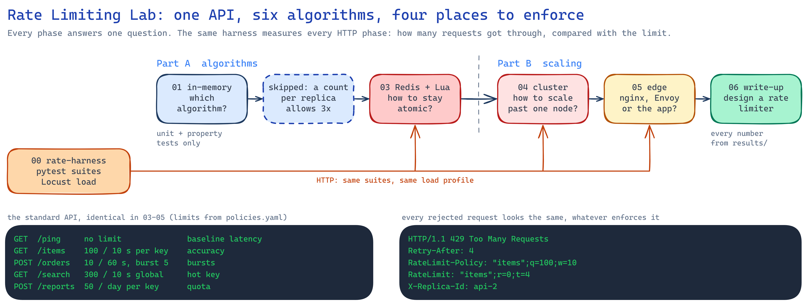
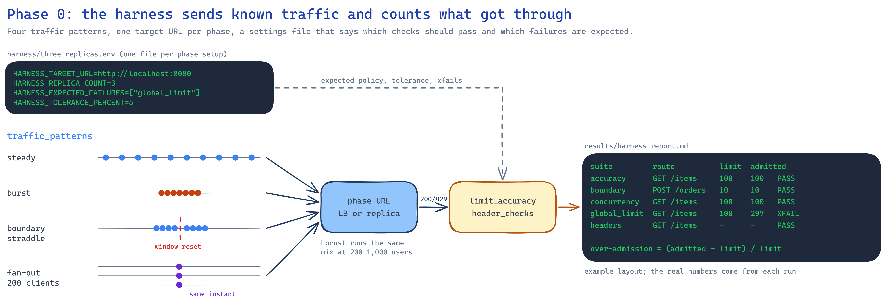

# Rate Limiting Lab

[](./LICENSE)

How do you stop one client from using up an API's capacity, and keep that working when the API
runs on many servers? This lab builds the same rate limiter several ways, from an in-memory
counter to Redis with Lua scripts to limits enforced at the edge, and runs the exact same tests
against each one.

---

## The problem

You add a limit: 100 requests per 10 seconds per API key. It works on your laptop. Then:

- *A client sends 100 requests just before the minute ends and 100 just after.* Both batches pass.
- *You scale to three replicas.* Every replica keeps its own count, so the real limit is 300.
- *You move the count to Redis.* Under load two replicas read 99, both allow, and the count ends
  at 101.
- *Redis restarts.* Do you let every request through, or reject every request?

Each of these is a design decision, and each one shows up in system design interviews.

## What this lab does

<p align="center"></p>

- 🧪 **One test harness for every setup.** Steady traffic, a burst on each side of a window reset,
  200 clients at the same instant, a global limit shared by all keys, the response headers, a
  store outage, and the latency the limiter adds.
- 📐 **Six algorithms behind one interface:** fixed window, sliding window log, sliding window
  counter, token bucket, leaky bucket and GCRA.
- 📊 **Every number is measured**, and the raw results are saved in each phase's `results/`.

| Phase | Status |
|---|---|
| 00 · test harness | ✅ |
| 01 · in-memory algorithms | ✅ |
| 02 · single-node middleware | ✅ |
| 03 · Redis + Lua | ✅ |
| 04 · Redis Cluster scaling | planned |
| 05 · edge rate limiting | planned |
| 06 · interview write-up | planned |

---

## Results

### 1. Six algorithms, one burst test

Limit: 100 requests per 10 s. A client sends 100 requests 0.5 s before a fixed window resets and
100 more 0.2 s after it. ([full table](01-in-memory-algorithms/results/algorithm-comparison.md))

| Algorithm | Admitted | Bytes per key |
|---|---|---|
| fixed window | **200** | 173 |
| sliding window log | 100 | **1,377** |
| sliding window counter | 102 | 169 |
| token bucket / leaky bucket | 107 | 161 |
| GCRA | 107 | 113 |

Only the log is exact, and it stores a timestamp per request. The sliding window counter gets
within 2% with two counters. The buckets and GCRA admit 100 plus the 7 tokens that refilled
between the bursts, exactly their rule. The fixed window doubles the limit.

### 2. Three replicas, three limits

The same API and the same limit (100 per 10 s per key) behind nginx, with the limiter's state in
each replica's memory. ([phase 02](02-single-node-middleware/README.md))

| Traffic on one key | 1 replica | 3 replicas |
|---|---|---|
| 150 requests at 50/s | 100 | **150** |
| 200 requests at once | 100 | **200** |
| 600 requests on a 300 global limit | 300 | **600** |

Every replica sees a third of the traffic and never reaches its own limit. A client also sees
`remaining` jump between replies, because each reply comes from a different replica's count.

### 3. One Redis, and why the check must be atomic

The same three replicas, now sharing one Redis. 200 requests on one key arrive at once, limit
100. ([phase 03](03-redis-centralized/README.md))

| How the replica talks to Redis | Admitted |
|---|---|
| GET the count, compare in Python, INCRBY | **117** |
| INCRBY first, compare after (fixed window) | 100, but 200 around a window reset |
| One Lua script: read, decide, write (sliding window counter) | 100, and 102 around a reset |

With Lua the three replicas are as exact as one process was in phase 1. Redis adds about
1–2 ms at p95.

### 4. When Redis stops answering

The harness pauses Redis while sending requests. Each route follows its own policy:

| Route | Policy | Result |
|---|---|---|
| `/items` | fail open | 10 / 10 answered 200, slowest 59 ms |
| `/orders` | fail closed | 10 / 10 answered 503 with `Retry-After` |
| `/search` | local fallback | each replica limits at a third of the global limit |

A 50 ms timeout and a circuit breaker keep a dead Redis from slowing every request down.

---

## The test harness

<p align="center"></p>

The harness never imports server code. It talks HTTP to a URL, and a small settings file per setup
says which checks should pass and which failures are expected, so an expected failure shows up as
`XFAIL` instead of red.

How it decides pass or fail: starting from an empty limit, any correct algorithm admits at most
`limit` at once plus what refills while the batch is being sent (`limit × elapsed / window`).
Anything above that, plus a 5% tolerance, is over-admission.

| Suite | Traffic | Passes when |
|---|---|---|
| `accuracy` | 150 requests at 50/s on one key | admitted stays within the bound |
| `boundary_burst` | 100 just before a window reset, 100 just after | the most admitted in any window stays within the bound |
| `concurrency` | 200 requests on one key released at once | admitted stays within the bound |
| `global_limit` | 600 requests from 50 keys | the shared limit holds across replicas |
| `headers` | 110 sequential requests | `RateLimit` / `RateLimit-Policy` match the policy, `429` has `Retry-After` |
| `failover` | store killed, then requests | fail-open routes answer 200, fail-closed routes 503, nobody waits |
| `latency_overhead` | 200 requests on `/ping` and on a limited route | p95 difference within budget |

The harness uses aiohttp and opens its connections before any timed traffic. The first version
used httpx: with 50 requests in flight it managed about 100 requests/s while Apache Bench got
1,380/s from the same API, and opening connections through Docker Desktop's port forwarding added
seconds. The bursts that should land 1.2 s apart landed 6 s apart, which made the boundary test
meaningless.

---

## Run it locally

### Prerequisites

- Python 3.11+ and Docker Desktop
- Windows PowerShell commands below; on macOS/Linux use `.venv/bin/python` instead of
  `.\.venv\Scripts\python.exe`

### Install the harness

```powershell
cd rate-limiting-patterns\rate-harness
python -m venv .venv
.\.venv\Scripts\python.exe -m pip install -e ".[dev]"
.\.venv\Scripts\python.exe -m pytest          # harness self-tests
```

### Start one setup and test it

```powershell
cd ..\02-single-node-middleware
docker compose up -d --build --wait           # API + nginx on :8080

cd ..\rate-harness
$env:HARNESS_ENV_FILE = "../02-single-node-middleware/harness/single-replica.env"
.\.venv\Scripts\python.exe -m pytest tests/suites -rxXs
.\.venv\Scripts\locust.exe -f load/locustfile.py --headless --host http://localhost:8080 --only-summary
```

Swap the folder and the settings file for any other setup:

| Setup | Start | Harness settings |
|---|---|---|
| 02 · one or three replicas | `docker compose up -d --build --wait` (`$env:API_REPLICAS="3"` for three) | `harness/single-replica.env`, `three-replicas.env`, `fixed-window.env` |
| 03 · Redis + Lua | `docker compose up -d --build --wait` | `harness/redis-lua.env`, `naive.env`, `incr.env` |

Each phase README lists the exact settings for every variant.

### Clean up

```powershell
docker compose down
```

Then quit Docker Desktop. On Windows, also run `wsl --shutdown` to free the memory.

---

## Project structure

```text
rate-limiting-patterns/
├── rate-harness/              the client side: pytest suites, Locust profile
│   ├── src/rateharness/       config, traffic patterns, limit accuracy, header checks, report
│   ├── tests/suites/          the seven behaviour checks, one pytest marker each
│   ├── tests/unit/            harness self-tests against an in-process stub API
│   └── load/                  Locust user + load shape
├── 01-in-memory-algorithms/   six algorithms, property tests, benchmark
├── 02-single-node-middleware/ FastAPI middleware, policies.yaml, nginx, 1 or 3 replicas
├── 03-redis-centralized/      Lua scripts, failure policy + circuit breaker, Prometheus, Grafana
├── docs/images/               diagrams (.excalidraw source + .png)
└── ruff.toml, LICENSE
```

## License

MIT, see [LICENSE](./LICENSE).
